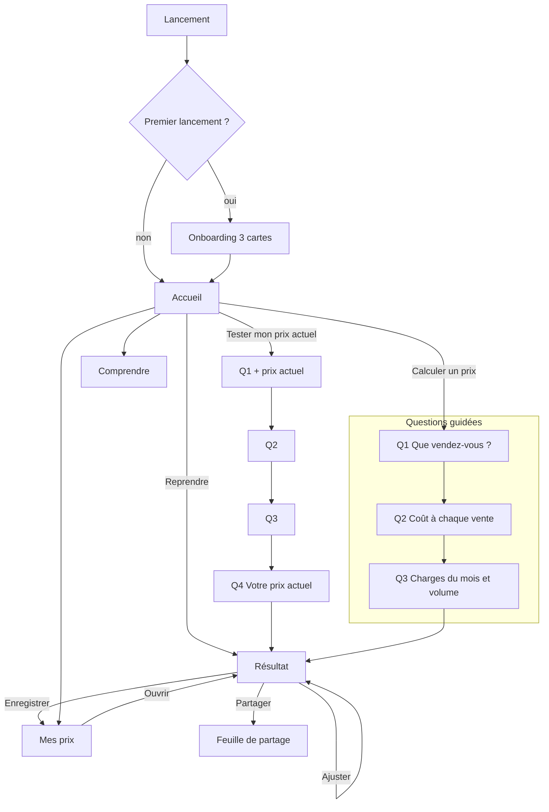

# 13 — Parcours utilisateur

Cible : **app publique, lot 1**. Part de l'existant ([05](05-audit-existant.md), [07](07-brief-ux.md)) et vise : *moins à remplir, un résultat vite, le moins de clics possible, mobile d'abord, avec une disposition propre à la tablette et au PC*.

## 1. Constat sur le parcours actuel

Dans le prototype, pour obtenir un prix à partir de zéro, l'utilisateur doit remplir :

| Bloc | Champs minimum |
|---|---|
| Activité | nom, unité (2) |
| Coûts directs | libellé, quantité, prix pour chaque ligne (≈ 3 × 4 lignes) |
| Charges fixes | libellé, montant pour chaque ligne (≈ 2 × 5 lignes) |
| Volume, marge, frais, arrondi | 4 réglages |
| **Total** | **≈ 30 champs**, résultat dans un panneau qui, sur mobile, est **sous** les saisies |

Les exemples préremplis cachent ce coût : on ne voit le problème qu'en partant d'un calcul vierge.

## 2. Principes du nouveau parcours

1. **Résultat d'abord, affinage ensuite.** Un premier prix apparaît avec **3 nombres**. Tout le reste a une valeur par défaut raisonnable et s'ajuste *après*, en regardant le prix bouger.
2. **Une question à la fois sur mobile**, tout visible sur grand écran.
3. **Total ou détail, au choix.** Pour les coûts, on peut saisir un total ou détailler ligne par ligne. Le détail est une aide, pas une obligation.
4. **Cocher plutôt que taper.** Les charges fréquentes sont proposées sous forme de pastilles à activer, avec montant.
5. **Défauts intelligents** par type d'activité (marge, frais, arrondi, unité), issus du prototype.
6. **Le nom vient à la fin**, à l'enregistrement (suggestion préremplie).
7. **Rien n'est perdu.** Brouillon enregistré automatiquement, retour arrière sans effacer, suppression avec annulation.
8. **Pédagogie au moment de la question**, pas dans un onglet à part.

### Budget de saisie cible

| Indicateur | Prototype | Cible |
|---|---|---|
| Nombres à saisir pour un premier prix | ≈ 20 | **3** (coût par vente, charges du mois, volume) |
| Taps pour un premier prix, depuis l'accueil | > 25 | **≤ 8** |
| Temps jusqu'au premier prix | inconnu | **≤ 60 s** (à vérifier en test) |
| Champs obligatoires | nom, unité, lignes | **aucun texte** obligatoire |

## 3. Les trois trajectoires

### Trajectoire 1 — Premier prix rapide (cœur du produit)

| Étape | L'utilisateur | L'écran | Taps / saisies |
|---|---|---|---|
| 1 | Touche **Calculer un prix** | Accueil | 1 tap |
| 2 | Choisit son activité (3 pastilles) | Q1 | 1 tap |
| 3 | « Suivant » (nom facultatif, ignoré) | Q1 | 1 tap |
| 4 | Saisit **ce que lui coûte une vente** | Q2 | 1 nombre + 1 tap |
| 5 | Saisit **charges du mois** et **ventes par mois** | Q3 | 2 nombres |
| 6 | **Voir mon prix** | Q3 → Résultat | 1 tap |
| | **Total** | | **5 taps + 3 nombres** |

### Trajectoire 2 — Tester mon prix actuel

Même chose, plus **Q4 « À quel prix vendez-vous ? »**. Le résultat s'ouvre sur **Mon prix** (verdict, marge réelle, seuil) avec le prix conseillé en comparaison. C'est le même écran de résultat, seul l'onglet actif change.

### Trajectoire 3 — Reprise et suite

- **Reprendre** : l'accueil montre le brouillon (« Bissap, 3 questions sur 3 ») et rouvre au bon endroit.
- **Enregistrer** : une feuille propose le nom (suggéré), un tap, retour en place avec confirmation.
- **Réviser un prix** : depuis « Mes prix », ouvrir ramène au résultat avec toutes les valeurs ; on ajuste, on réenregistre ou on enregistre une copie.

## 4. Profondeur des saisies (progressive disclosure)

| Niveau | Ce qu'on voit | Quand |
|---|---|---|
| **1 — Express** | 3 nombres, défauts par activité | Toujours |
| **2 — Ajuster** | Marge, frais de paiement, arrondi, TVA (HT/TTC), prix du concurrent | Depuis le résultat, sans quitter l'écran |
| **3 — Détailler** | Lignes de coûts directs, charges fixes cochées une à une, rémunération | Au choix, depuis Q2 et Q3 |
| **4 — Mon activité** | Charges partagées entre produits | Dès le 2ᵉ produit enregistré |

## 5. Garde-fous qui compensent la simplification

Saisir moins ne doit pas produire un prix faux. Trois alertes obligatoires dans l'express :

| Risque | Garde-fou |
|---|---|
| Oublier sa propre rémunération (piège n°1 du prototype) | Q3 propose une pastille **Ma rémunération** mise en avant ; si le total saisi n'en contient pas, un rappel non bloquant s'affiche (« Avez-vous compté votre salaire ? ») avec un tap pour l'ajouter |
| Volume irréaliste | Rappel « soyez réaliste » et alerte si volume = 0 (RG-08) : pas de prix |
| Coûts directs incomplets | Q2 propose des pastilles « + transport », « + emballage », « + pertes » |

Ces rappels apparaissent **une fois par calcul**, dans un langage simple, jamais en blocage (décision à confirmer : Q-28).

## 6. Mesures de réussite du parcours

| Mesure | Cible |
|---|---|
| Temps jusqu'au premier prix, en test avec 5 commerçants | ≤ 60 s médiane |
| Abandon dans les questions guidées | < 15 % |
| Taux d'ouverture de « Ajuster » | > 40 % (le résultat donne envie d'explorer) |
| Compréhension : « pourquoi ce prix ? » | ≥ 4 testeurs sur 5 |
| Erreur de saisie corrigée sans aide | ≥ 90 % |

Mesurées en **test utilisateur** (aucune collecte automatique au lot 1, voir [ADR-0006](adr/0006-donnees-personnelles-et-consentement.md)).
