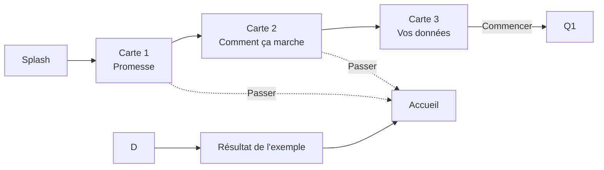

# 14 — Onboarding (premier lancement)

## Objectif

Faire passer la personne de « une appli de plus » à **son premier prix**, en moins de 90 secondes, sans compte et sans permission demandée. L'onboarding explique la promesse, le fonctionnement, et rassure sur les données, **puis s'efface**.

## Principes

- **Court** : 3 cartes maximum, passable à tout moment.
- **Utile avant d'être joli** : chaque carte répond à une question que se pose l'utilisateur.
- **Apprendre en faisant** : l'issue naturelle est de lancer un vrai calcul, pas de lire un tutoriel.
- **Aucune demande** de compte, de notification, de localisation, d'e-mail.
- **Rejouable** depuis Réglages → « Revoir la présentation ».

## Déclenchement

| Condition | Comportement |
|---|---|
| Premier lancement (drapeau `onboarding_vu` absent) | Affiche l'onboarding après un splash ≤ 1 s |
| Lancement suivant | Accueil direct |
| Drapeau corrompu | Traité comme premier lancement (jamais d'erreur) |
| Lien web partagé vers un contenu (futur) | Onboarding ignoré, ouverture du contenu |

## Séquence

## Les cartes

| # | Titre | Message | Visuel (à concevoir) | Action |
|---|---|---|---|---|
| 1 | **Le bon prix, en une minute** | Vendez-vous à perte sans le savoir ? Trois questions suffisent pour savoir à quel prix vendre. | Illustration simple d'un ticket de caisse qui se compose | Suivant · Passer |
| 2 | **Trois questions, c'est tout** | Ce que vous vendez · ce que ça vous coûte · vos charges du mois. Le reste se règle ensuite, en regardant le prix bouger. | Trois pastilles reliées, dernière = prix | Suivant · Passer |
| 3 | **Vos chiffres restent chez vous** | Rien ne quitte votre téléphone. L'application marche sans internet. | Cadenas ou téléphone, sans jargon | Deux boutons ci-dessous |

Textes provisoires : la voix et le ton seront fixés dans le guide de rédaction (voir [07](07-brief-ux.md)) et **validés par la comptable** pour le fond.

### Fin de la présentation (carte 3)

| Bouton | Hiérarchie | Résultat |
|---|---|---|
| **Commencer** | Unique | Ouvre Q1 ; l'onboarding est marqué vu |

*Décision du 2026-11-19 : « Voir un exemple d'abord » est retiré de la carte 3 (un seul bouton).* L'exemple guidé reste construit et joignable à l'adresse `#/exemple`, mais **n'a plus de point d'entrée dans l'app** : à replacer (Accueil, lien « Voir un exemple » de Q2) ou à supprimer.

## Exemple guidé

Pour qui hésite : un calcul **déjà rempli** (bissap, issu du prototype), avec des bulles d'aide qui montrent où regarder.

| Étape | Mise en évidence | Bulle |
|---|---|---|
| 1 | Prix conseillé | « Voici le prix à viser : 450 F. » |
| 2 | Barre de composition | « Voilà d'où vient ce prix : ce que ça vous coûte, vos charges, votre marge. » |
| 3 | Curseur de marge | « Changez la marge, regardez le prix bouger. » (le curseur est essayable) |
| 4 | Bouton Enregistrer | « Gardez vos prix pour les retrouver. » |
| Fin | Bouton **Faire le mien** | Ouvre Q1 avec les champs **vides** |

Règles : l'exemple est **clairement étiqueté** « Exemple » (bandeau permanent), n'est **jamais** enregistré dans « Mes prix » sans action, et se quitte en un tap. Les bulles sont passables et ne bloquent pas l'écran.

## Premier prix : accompagnements contextuels

Après l'onboarding, les aides apparaissent **une seule fois** au moment pertinent (pas de visite guidée en cascade) :

| Moment | Aide |
|---|---|
| 1ʳᵉ ouverture de Q2 | « Comptez tout ce que vous dépensez pour **une** vente. » + lien « Voir un exemple » |
| 1ʳᵉ ouverture de Q3 | « Ce que vous payez chaque mois, même sans vendre. N'oubliez pas votre salaire. » |
| 1ᵉʳ résultat | Bulle sur « Ajuster » : « Essayez une autre marge. » |
| 1ᵉʳ enregistrement | « Retrouvez vos prix dans Mes prix. » |

Chaque aide pose un drapeau (`aide_q2_vue`…) pour ne plus réapparaître ; elles sont réinitialisables dans Réglages.

## Données

| Donnée | Type | Stockage | Remarque |
|---|---|---|---|
| `onboarding_vu` | booléen + version | local | Version pour pouvoir **rejouer** un onboarding refondu |
| `aides_vues` | ensemble de clés | local | Réinitialisable |
| `derniere_activite_choisie` | enum | local | Pré-sélectionne Q1 aux calculs suivants |

Aucune donnée personnelle, aucun envoi réseau.

## États

| État | Comportement |
|---|---|
| Chargement | Splash ≤ 1 s, jamais d'écran vide |
| Hors ligne | Identique : rien ne dépend du réseau |
| Retour arrière | Revient à la carte précédente, état conservé |
| Interruption (appel, changement d'app) | Reprend sur la même carte |
| Texte agrandi, lecteur d'écran | Cartes lisibles, ordre de focus logique, « Passer » toujours atteignable |

## Critères d'acceptation

**ONB-01** — *Given* un premier lancement, *When* l'app s'ouvre, *Then* la carte 1 s'affiche en < 1,5 s et « Passer » est visible.

**ONB-02** — *Given* l'utilisateur touche « Passer » sur n'importe quelle carte, *Then* il arrive sur l'Accueil et l'onboarding n'est plus proposé.

**ONB-03** — *Given* la carte 3, *When* il choisit « Commencer », *Then* Q1 s'ouvre avec tous les champs vides.

**ONB-04** — *Given* l'exemple guidé, *When* l'utilisateur le quitte, *Then* aucun prix n'est ajouté à « Mes prix ».

**ONB-05** — *Given* Réglages → « Revoir la présentation », *Then* l'onboarding rejoue sans modifier les données.

**ONB-06** — *Given* aucune connexion, *Then* l'onboarding s'affiche et fonctionne à l'identique.

**ONB-07** — *Given* « réduire les animations » activé, *Then* aucune carte ne se déplace : fondu enchaîné uniquement.
